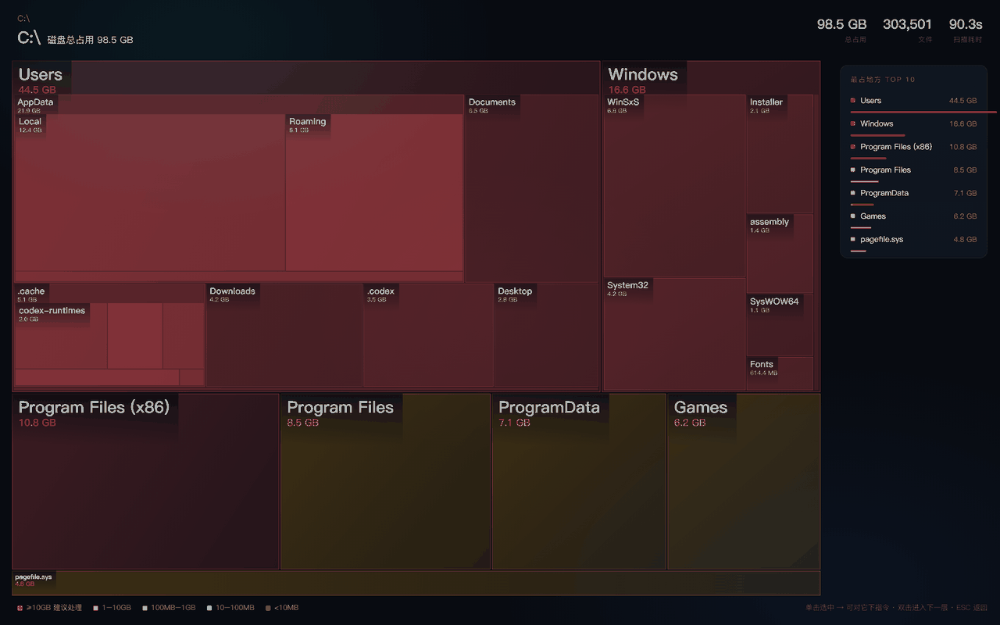

# DiskSurgeon

**Diagnose. Prescribe. Operate.** A disk-space agent for Windows that doesn't stop at showing you what's big.

Most disk tools answer one question: *which folder is big?* DiskSurgeon answers the two you actually have:

- **"What is this thing, and what breaks if I delete it?"**
- **"This folder has to stay — can I just get it off the C drive?"**



> Screenshot rendered from fully synthetic data (`docs/gen_demo.py`). No real machine paths.

---

## The three moves

### 1. Map — area is size, colour is a verdict

Scans any drive or folder and renders a squarified treemap as a **single self-contained HTML file**: no CDN, no build step, no external library, shareable as one file.

| You see | It means |
|---|---|
| Block **area** | How much space it takes. You don't need to read a single number. |
| **Red** | ≥ 10 GB — deal with it |
| **Orange** | 1–10 GB — worth a look |
| **Cyan / blue** | 10 MB – 1 GB — normal |
| **Grey** | < 10 MB — ignore |

Click to drill down, breadcrumb to come back, TOP 10 list on the right. Colours come from size thresholds rather than file type, so the map reads the same on every machine.

Measured: 122 GB / 888,000 files in 90 seconds on a warm cache, with hardlink deduplication on.

### 2. Checklist — every item states its own worst case

The same scan produces a second view: a **tickable cleanup list** in three groups.

| Group | What lands there |
|---|---|
| ✅ **Safe to delete** | caches, logs, temp, old installers, migration leftovers, GPU shader caches |
| ⚠️ **Your call** | runtime dependencies, browser profiles, project `node_modules` — each with the cost spelled out |
| 🚫 **Hands off** | OS directories, keys, fonts, game saves — these **cannot be ticked**, the UI refuses |

Each row carries a one-sentence *worst case* in plain language:

> **Old installer** → "The update finished long ago; this just takes up room. Deleting it won't affect the version you run now — you'd only re-download if you wanted to go back."

Tick what you want, hit **Copy cleanup request**, and the result is a complete itemised authorisation you can hand to an agent (or to yourself) — which is how this repo is meant to be used.

**Judgement is positional, not name-based.** `C:\Windows` is the OS. `AppData\Local\Microsoft\Windows` is a 792 MB thumbnail cache. Matching on the bare name would lock the second one shut and make the whole list untrustworthy. Rules are split into `FORBIDDEN_ANY` / `OS_ROOT_NAMES` / `APPDATA_CACHE_NAMES`, so that *deletable things are never falsely locked* and *dangerous things are never falsely freed*.

Audit any verdict yourself:

```bash
python skills/disk-doctor/scripts/make_checklist.py --why "C:\Windows" "C:\Users\me\AppData\Local\Microsoft\Windows"
# 🚫  C:\Windows                                   → forbidden | OS itself, deleting it means no boot
# ✅  C:\Users\me\AppData\Local\Microsoft\Windows  → safe / application cache
```

### 3. Relocate — move the folder, keep the program working

Some folders can never be deleted: model weights, chat history, project data. So move them.

The folder goes to another drive; a **directory junction** (`mklink /J`) stays behind in its place. The program opens the same path it always did and never knows.

Three gates, none skippable:

```powershell
# Gate 1 — preflight (read-only). Prints RESULT: GO or NO-GO.
powershell -ExecutionPolicy Bypass -File skills\disk-doctor\scripts\preflight_check.ps1 `
  -Source "C:\Users\me\.codex" -Target "D:\AgentData\.codex"

# Gate 2 — dry run. Prints the plan, moves nothing.
powershell -ExecutionPolicy Bypass -File skills\disk-doctor\scripts\move_with_junction.ps1 `
  -Source "C:\Users\me\.codex" -Target "D:\AgentData\.codex" -DryRun

# Gate 3 — only after you personally say go:
powershell -ExecutionPolicy Bypass -File skills\disk-doctor\scripts\move_with_junction.ps1 `
  -Source "C:\Users\me\.codex" -Target "D:\AgentData\.codex" -Force
```

Order of operations inside: `robocopy` (source kept) → verify → delete source → `mklink /J` → verify. Any step failing halts the whole thing.

Rollback is one command:

```powershell
powershell -ExecutionPolicy Bypass -File skills\disk-doctor\scripts\rollback_junction.ps1 `
  -Source "C:\Users\me\.codex" -Target "D:\AgentData\.codex" -Force
```

---

## Quick start

**Requirements:** Windows 10/11. Python 3.8+ — **standard library only**, nothing to `pip install`.

```bash
git clone https://github.com/pandarick916/disksurgeon.git
cd disksurgeon/skills/disk-doctor

# scan (read-only)
python scripts/scan_disk.py --path "C:\" --min-size 50 --depth 7 --out scan.json

# map + image + checklist, opened in your browser
python scripts/make_report.py scan.json --open --png --with-checklist
```

You get:

| File | What it is |
|---|---|
| `scan.html` | the interactive treemap, one self-contained file |
| `scan.png` | the same map as an image, for chat or a slide |
| `scan_cleanup.html` | the tickable checklist |

Useful flags:

| Flag | Default | When to change it |
|---|---|---|
| `--path` | `C:\` | Point it at `D:\`, or at `C:\Users\<you>` to scan just your profile (much faster) |
| `--min-size` | 50 (MB) | Go to `5` when hunting scattered junk; raise it on slow disks |
| `--depth` | 7 | Rarely worth touching |
| `--fast` | off | Skips hardlink dedup — about 2× faster, but `WinSxS` inflates. Don't use it when you're about to delete something |

### Why the numbers are smaller than Explorer's

They're supposed to be. `C:\Windows\WinSxS` holds a huge number of files that are *the same bytes* as files in `System32`, just under another name. Explorer counts both; this tool counts the data once. The scan reports how much it de-duplicated in `dedup_bytes` — on a typical Windows box that's 8–12 GB. The smaller number is the one that matches real disk usage.

Junctions and symlinks are never followed, for the same reason: one set of bytes must not be counted twice, and a link loop must not hang the scan.

---

## Use it as an agent skill

The repo is also a packaged expert for WorkBuddy / Craft-style agents:

```
.codebuddy-plugin/plugin.json   # manifest
agents/disk-doctor.md           # agent persona + workflow rules
skills/disk-doctor/             # the tooling the agent calls
```

Drop the folder into your expert directory and register it. The persona is deliberately opinionated: it is instructed to refuse making deletion decisions on the user's behalf, to run preflight before any move, and to classify failures by cause instead of guessing.

---

## Safety model

This tool deletes and moves real files. The rules below are not decoration; they came out of breaking things.

1. **Diagnosis never writes.** Scanning is `scandir` + `stat`. Nothing else.
2. **Deletion goes to the Recycle Bin**, not straight to the void.
3. **The Recycle Bin is not free space.** This is the trap behind most phantom savings reports: the folder looks empty, the drive doesn't move. Empty the bin, then re-read free space from the OS — never trust the number the delete step printed.
4. **Junctions only (`/J`)**, never directory symlinks (`/D`).
5. **To remove a link, `rmdir "link"` with no `/s`.** Never `del /s`, never delete it in Explorer — both follow the link and eat the real data on the other drive. This is the one operation in the whole tool that can cause irreversible loss.
6. **One folder at a time.** Move, verify, then the next.
7. **The program must be fully closed** — tray icons and background services included — or you get a half-moved folder.
8. **`Windows`, `Program Files`, `ProgramData` are never moved.** Docker/WSL `.vhdx` files go through the vendor's own relocation, not this one.

---

## Known limitations

- **Windows-first.** Scan, map and checklist run on macOS too; relocation there uses `ln -s` and is restricted to pure caches, because some macOS apps refuse to follow a symlink out of their sandbox.
- **No Linux.** Different filesystem semantics; not pretending otherwise.
- **No data recovery.** If something is already gone, stop writing to that disk and use a proper recovery tool.
- Antivirus quarantine, restore points and hibernation files are out of scope — those belong in system settings.
- **Upgrades rebuild folders.** If you relocate a program's data directory and later update that program, it may recreate the directory on C:. Move it again.

---

## License

MIT — see [LICENSE](LICENSE). Relocation tooling derives from `windows-disk-relief` (MIT).

---

## 中文速览

**DiskSurgeon = 磁盘外科医生**：诊断（扫出可视化地图）→ 处方（可勾选清理清单，每条写明最坏情况）→ 手术（用 junction 把大目录搬到别的盘，程序照常运行）。

```bash
python scripts/scan_disk.py --path "C:\" --min-size 50 --out scan.json
python scripts/make_report.py scan.json --open --png --with-checklist
```

三个和其他磁盘工具不一样的地方：

1. **面积即占用**：方块大小就是占多少，红橙青灰直接给结论，不用读数字。
2. **每条都写「删了会怎样」**：系统目录锁死勾不上，能删的不会被误锁。
3. **能搬不能删的目录，搬走**：junction 传送门，程序无感；预检 → 干跑 → 你亲口说搬，随时可回滚。

⚠️ 两条血泪提醒：删完**必须清空回收站**，否则空间根本没还你；删链接只能用 `rmdir`，用 `del /s` 或资源管理器删会顺着链接吃掉另一块盘的真数据。
